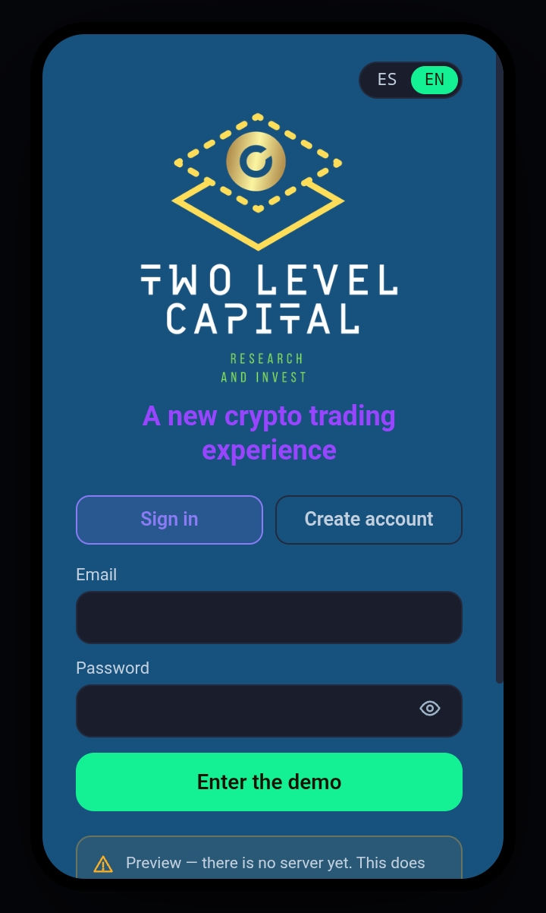

# Two Level Capital dApp v0_2
Aquí contiene los archivos de la version de la dApp (0.2) con submisión de cambios hasta 30 octubre 2026





La versión provisional (el link puede cambiar o estar obsoleto y no corresponder ) puede consultarse en el siguiente link:
[Link to artifact Claude:](https://claude.ai/artifact/Gk9e1KA2xFPPKrzdhz4ARA)


# build_tools — del prototipo (.jsx) a la página publicada (.html)

El `.jsx` es la fuente de verdad. Pasos:

1. `python3 build_html.py ../dashia_app_prototype.jsx icons_and_chart.jsx ../dashia_app.html ../dashia_app.html`
   (reemplaza imports, storage, llamada a la IA, descarga y gráficos por sus equivalentes publicables;
   cada reemplazo verifica que el texto exista y falla en voz alta si el .jsx cambió de forma).
2. Verificar ANTES de publicar (esbuild solo valida sintaxis; en esta sesión una edición rompió la app y la
   sintaxis seguía pasando): extraer el script del HTML, transformarlo con
   `esbuild --loader=jsx --jsx=transform` y correr `node smoke_test.js`, que ejecuta cada pantalla con un
   React de mentira y revisa que las traducciones coincidan en ES/EN.
3. Publicar actualizando la misma URL.

Límite del smoke test: ejecuta el render inicial, NO los efectos (carga de sesión, voz, llamadas a la IA) ni
clics reales. Eso solo se confirma abriendo la página.

# trading_backend

Nueve paquetes pensados para vivir juntos en el backend:

- `dashia_engine/` — port del algoritmo DASHIA (features, ANN Lorentziano, kernel, backtest)
- `credentials_vault/` — bóveda multiusuario de API keys, cifrado real
- `binance_connector/` — Binance (ccxt, spot+futuros) + gateway de límites duros
- `bybit_connector/` — Bybit (ccxt, spot+futuros linear) — reutiliza el gateway de Binance
- `weex_connector/` — Weex (ccxt, spot+swap) — sin verificación automática de permisos, confirmación manual
- `solana_connector/` — Jupiter v1+v2, wallet operativa, RPC
- `market_data/` — capa unificada de precios/velas, con Birdeye/GeckoTerminal de respaldo
- `agent_sandbox/` — DSL restringido + aislamiento de proceso real + gateway + **cálculo de indicadores bajo demanda**
- `agent_runtime/` — **el orquestador**: un solo llamado (`run_agent_tick_for_user`) arma market_data, el gateway y la posición del agente automáticamente desde la bóveda
- `stats/` — lee los logs de auditoría reales que los gateways ya escriben, reconstruye operaciones con P&L, y exporta a CSV
- `auth/` — registro/login/sesiones con scrypt, bloqueo por intentos y defensa contra enumeración por tiempo (ver `auth/README.md` para sus límites)
- `agent_runtime/scheduler.py` — el scheduler: corre `run_agent_tick_for_user()` cada N minutos, para cada agente activo de cada usuario, solo

## Instalación conjunta

```bash
pip install ccxt solders solana base58 requests pandas numpy matplotlib pytest cryptography
python -m pytest binance_connector/tests/ bybit_connector/tests/ weex_connector/tests/ \
                  solana_connector/tests/ agent_sandbox/tests/ credentials_vault/tests/ \
                  market_data/tests/ agent_runtime/tests/ -v
python -m dashia_engine.demo
```

## El flujo completo, de punta a punta

```
Usuario conecta sus exchanges (credentials_vault, cifrado real)
        │
        ▼
market_data.build_market_data_for_user() -> UnifiedMarketData
        │
        ▼
agent_runtime.run_agent_tick(source, symbol, market_data, gateway, ...)
        │
        ├─ market_data.get_ohlcv() -> velas reales
        ├─ agent_runtime.derive_trend() -> variable `trend`
        ├─ agent_sandbox.evaluate_and_execute():
        │     Capa 1 (DSL restringido) -> Capa 2 (proceso aislado,
        │     indicadores calculados bajo demanda con dashia_engine) ->
        │     Capa 3 (gateway con límites duros)
        │
        ▼
binance_connector / bybit_connector / weex_connector / solana_connector
        │
        ▼
Orden real en el exchange
```

262 tests (última corrida completa, 15-sep) + 40 de `auth` (corridos con unittest), corriendo de verdad (no mocks donde importa: cifrado real,
procesos reales con límites de memoria/CPU/red reales, indicadores
calculados contra dashia_engine real).


# Blueprint técnico y de seguridad
### App de trading con agentes de IA (CEX + DEX Solana)

---

## 1. Principios de seguridad no negociables

1. **No custodia en CEX.** Las API keys de exchange se crean con permisos de *solo trading* (spot/futuros), **sin permiso de retiro**, y con whitelist de IP fija hacia nuestros servidores. La app nunca debe poder mover fondos fuera de la cuenta del usuario, ni aunque un atacante robe la key completa.
2. **No custodia en DEX.** La llave privada de Solana nunca sale de Phantom. La app arma la transacción (swap vía Jupiter/Raydium) y la envía a Phantom para firma — vía *wallet-adapter* (web/desktop) o *deep link* (móvil). Nosotros nunca vemos ni tocamos la clave privada ni la seed phrase.
3. **Ejecución de agentes = ejecución de código no confiable.** Un agente creado por un usuario es, técnicamente, código arbitrario con permiso de generar órdenes de trading. Se trata con el mismo nivel de desconfianza que "código subido por un desconocido a un servidor de producción".
4. **Cada llamada de trading pasa por un gateway propio**, nunca el agente llama directo al exchange. El gateway aplica límites duros independientes del agente (ver §4).
5. **Defensa en profundidad**: ningún control es "el único". Si el sandbox del agente falla, el gateway lo detiene. Si el gateway falla, los límites del propio exchange (sin retiro) lo contienen.

---

## 2. Custodia de credenciales (CEX)

- **Cifrado por sobres (envelope encryption):** cada API key se cifra con una clave de datos única (DEK), y esa DEK se cifra con una clave maestra (KEK) guardada en un KMS/HSM gestionado (AWS KMS, GCP KMS o HashiCorp Vault). La app nunca ve la key en texto plano; solo el microservicio de ejecución la descifra en memoria, por el tiempo mínimo necesario.
- **Whitelist de IP** en el exchange apuntando solo a la IP saliente fija de nuestro clúster de ejecución.
- **Rotación y revocación** con un botón de "desconectar" visible en la app que revoca la key del lado del usuario (ellos la borran en su cuenta de Binance/Bybit/Weex) y la eliminamos de nuestra bóveda al instante.
- **Verificación de permisos al conectar:** al vincular una key, llamamos un endpoint de solo lectura del exchange para confirmar que el permiso de retiro está desactivado, y **rechazamos la key si no lo está.**
- Nota: hay que verificar caso por caso qué permisos de API granulares ofrece cada bróker — Binance y Bybit tienen controles maduros de "solo trading"; confirmar el nivel de granularidad que ofrece Weex antes de habilitarlo.

## 3. Conexión no-custodial (Solana / DEX)

- **Wallet-adapter / deep link a Phantom** para cada transacción — nunca un "connect-once y firma automática ilimitada". Cada swap requiere una firma explícita, salvo que el usuario active un modo "sesión" con un límite de gasto y expiración corta (ej. sesión de 15 min, tope de $X por operación), que es un patrón estándar de wallets tipo *session keys*.
- **Ejecución rápida:** Jupiter como agregador de rutas + un RPC dedicado (Helius, o alternativas como Triton/QuickNode) con *priority fees* dinámicos para reducir el fallo de transacción en momentos de congestión. Raydium como ruta directa cuando Jupiter no cubra el par.
- **Slippage y protección de MEV:** límites de slippage configurables por el usuario, y usar los endpoints "protegidos" que ofrecen los RPC privados para reducir sandwich attacks en memecoins de baja liquidez.

## 4. Sandbox de agentes + gateway de trading

- **Aislamiento de ejecución:** cada agente corre en un contenedor o microVM (Firecracker/gVisor) sin acceso a red directo, sin acceso al sistema de archivos del host, con límites estrictos de CPU/memoria/tiempo de ejecución.
- **El agente no llama al exchange.** Solo puede llamar a una API interna nuestra ("quiero comprar X, vender Y, con este tamaño") — el gateway decide si la orden se ejecuta.
- **Límites duros en el gateway, independientes del agente:**
  - Tamaño máximo de posición por operación y por símbolo.
  - Pérdida máxima diaria por agente (circuit breaker: si se toca, el agente se pausa automáticamente).
  - Lista blanca de símbolos operables (BTC, ETH, SOL, LTC, XRP, ARB, XAU, memecoins aprobadas).
  - Límite de operaciones por minuto (evita loops de trading descontrolados por un bug del agente).
- **Auditoría inmutable:** cada orden, señal y decisión del agente queda en un log append-only, con timestamp y el estado exacto de las variables que la generaron — necesario tanto para debugging como para la futura "competencia entre agentes" (verificabilidad de resultados).

## 5. Seguridad de la app y la cuenta del usuario

- 2FA obligatorio + biometría (Face ID / huella) para abrir la app y para cualquier acción sensible (conectar un bróker, aumentar límites de un agente).
- Certificate pinning en las llamadas app → backend.
- Ningún secreto (API key, seed) se guarda nunca en el dispositivo en texto plano; en iOS/Android se usa Keychain/Keystore solo para tokens de sesión, nunca para las credenciales de trading (esas viven cifradas en el backend, no en el teléfono).
- Rate limiting y detección de anomalías (ej. login desde país distinto + intento de aumentar límites de riesgo en la misma sesión = fricción extra o bloqueo temporal).

## 6. Stack técnico sugerido (punto de partida, no definitivo)

| Capa | Opción sugerida | Por qué |
|---|---|---|
| App móvil | React Native + Expo | Un solo código para iOS/Android, buen ecosistema para wallet-adapter de Solana |
| Backend | Node.js/TypeScript o Python (FastAPI) | Ambos con SDKs maduros para exchanges (ccxt) y Solana (web3.js / solana-py) |
| Sandbox de agentes | Firecracker microVMs o gVisor + colas (Redis/SQS) | Aislamiento real, no solo `eval()` con timeouts |
| Bóveda de secretos | HashiCorp Vault o AWS/GCP KMS | Envelope encryption estándar de la industria |
| Motor DASHIA | El paquete Python ya entregado | Corre dentro del backend, no depende de TradingView |

## 7. Lo que este blueprint NO resuelve (y hay que decidir aparte)

- Registro regulatorio si el producto pasa de "uso personal" a "multiusuario con custodia de API keys de terceros" — consultar abogado fintech antes de lanzar.
- Política de qué pasa si un agente de un usuario pierde dinero de otro usuario por un bug — define los términos de servicio.
- Nivel de responsabilidad legal por señales/trades ejecutados automáticamente sin supervisión humana en tiempo real.

---
*Documento vivo — se actualiza a medida que se implementa cada pieza.*

